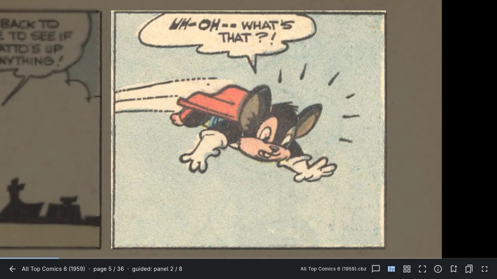
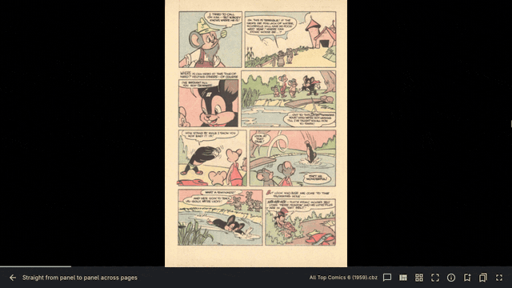
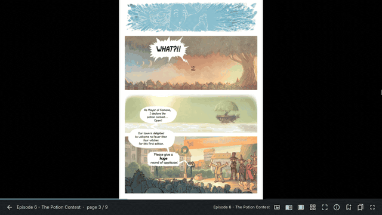
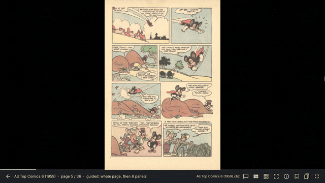
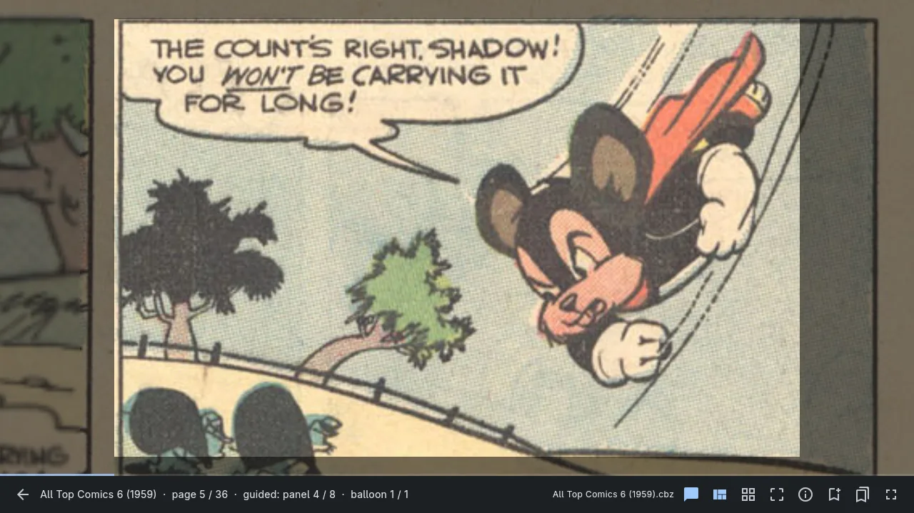
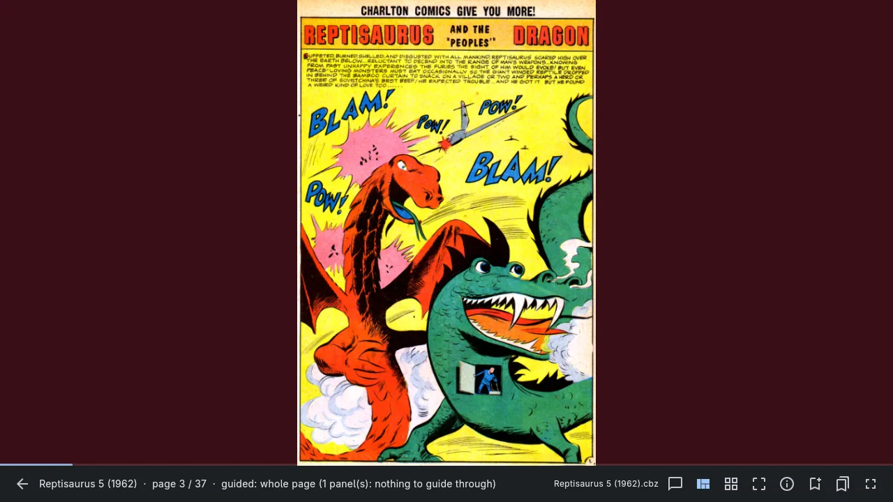

# 5. Guided view

[Contents](README.md) · Previous: [Reading a comic](04-reading.md) · Next: [Bookmarks and marks](06-bookmarks.md)

Guided view is the reason ComicRedr exists. Instead of shrinking a whole
page onto your screen, it moves from panel to panel, each one as large as
the screen allows, in reading order. The rest of the page stays visible
but dimmed, so you never lose your place.


This chapter has six short animations. If one doesn't move, click it to
play it.

## Panel by panel

1. Open a comic and press `v` (or the guided view button on the status
   line).
2. The page shows whole first, so you can take it in.
3. Each `→` (or `Space`, or a tap on the right edge) glides to the next
   panel. `←` goes back.
4. After the last panel the page shows whole once more, then the next
   page begins.
5. `v` again, or `Esc`, leaves guided view on the page you are on.

The status line says where you are: `guided: panel 2 / 6`.



On the phone a panel fills the width of the screen. The panels of this
comic were found on the laptop and came along in its
[sidecar file](11-your-data.md), so guided view was ready on the phone
straight away. Each tap on the right edge goes to the next panel:


Don't want the whole page before and after its panels? Press `w` to go
straight from the last panel of one page to the first panel of the next.
`w` again brings it back; Settings has the same switch.



Other keys that help in guided view:

- `↓` `↑` (or `j` `k`) look below and above the panel. What comes on
  screen is shown bright rather than dimmed; the next panel is framed
  and dimmed around as usual.
- On a touchscreen, drag with one finger to look around the panel, and
  pinch with two to zoom. A quick flick to the left or right steps to the
  next or previous panel; a slower drag only moves the page.
- `zz` or `=` centres the current panel again after you zoomed or moved.
- `PageDown` and `PageUp` skip to the next or previous page at once.
- `Tab` also cycles through single page, two pages and guided view.

Panels that aren't rectangles (slanted, round or cut at an angle) are
followed along their real edges, so the dimming hugs the panel's shape.

It works on modern art as well as on old scans. Here it steps through a
painted page of Pepper&Carrot whose panels have no gutters between them,
then shows the page whole before moving on:



## Balloon by balloon

Press `b` in guided view (or the speech-bubble button on the status line)
and each step stops on the next speech or thought balloon inside the
panel, in reading order, before moving on to the next panel. It is
wonderful on small screens and dense golden-age pages. `b` again goes back
to whole panels. Pressed outside guided view, `b` turns guided view on
with balloons.

When a balloon sits inside a small inset over a larger panel, it is read
with the inset. For example, the larger panel and its balloons come first,
then the inset and its balloons. A balloon crossing panel borders belongs
to whichever panel it overlaps most; equal overlaps go to the smaller
panel.

Narration boxes (captions) are not balloons, and balloon mode is meant to
skip them and read them as part of the panel; it mostly does, but now and
then it stops on one.





The status line counts the balloons too: `guided: panel 2 / 6 · balloon
1 / 3`.

## Pages shown whole

Not every page can be guided. A splash page, a cover, an advert or a page
of text has no panels to step through, and on some old scans the panel
finder isn't sure enough. Rather than move the camera somewhere wrong,
ComicRedr then shows the page whole and says why on the status line, for
example `guided: whole page (1 panel(s): nothing to guide through)`,
which means only one panel was found. On a page like that you can still
[enlarge a part by hand](04-reading.md#parts-of-a-page) (`21` for the
upper half, `31` for the top third, and so on).



### A quick press stays

When you are pressing `→` panel after panel, it is easy to skip past a
splash page without really looking at it. So as soon as guided view
has to show a page whole because it has no panels it trusts enough to
step through, the
background turns a dark wine red to tell you.

- Press `→` within 2 seconds of arriving and the page stays: it zooms
  out a little and back, to say you are still on it. The next `→` turns
  the page, however soon.
- Press `→` after 2 seconds and the page turns straight away: you have
  had time to look.

For example, on a splash page reached with a quick run of `→`, the next
`→` zooms the splash instead of skipping it; a second `→` moves on. Wait
a few seconds on it and one `→` is enough.


- Going back works the same way with `←`, and a tap or swipe does what
  the key does, on the laptop and on the phone.
- With reduced motion turned on in your desktop or phone settings, the
  page doesn't zoom; the status line says to press again instead.
- The 2 seconds can be changed in Settings, under the switch: 1, 2, 3,
  5 or 10 seconds. With 5, for example, you have five seconds on a
  splash page before one `→` moves on.
- `W` turns all of this off: no wine red, and such pages turn at once.
  Settings has the same switch.

## How panels are found

ComicRedr finds panels and balloons with a small detector (a trained
model, a kind of image recogniser) that is built into the app and runs
on your own computer or phone, about a fifth of a second a page on a
laptop. Nothing leaves your machine.

- Panels are found in the background for the comic you have open, with
  guided view on or off: first the page you are on, the two after it and
  the one before, then the rest of the comic ahead of you, a little at a
  time. So guided view
  is usually ready before you get there. Other comics are left alone
  until you open them, and closing a comic stops the work.
- The results are saved in the comic's [sidecar file](11-your-data.md),
  so a comic copied to your phone doesn't need finding again.
- The [details view](07-managing-comics.md#details-of-a-comic) (`I`)
  shows, page by page, how many panels and balloons were found and why a
  page is shown whole.

If a comic's panels look wrong after an update, `X` → **Redo panels**
finds them again (see
[Reset a comic](07-managing-comics.md#reset-a-comic)).

## Panels from a large AI model

The built-in detector is small so that it can run on a phone, and some
pages beat it: slanted panels, old scans, panels on black. For a comic
you care about you can have a large AI model that sees pictures, such
as Claude (in Claude Code) or Codex, mark up its panels and balloons
once, and put the result in the comic's
[sidecar](11-your-data.md). Guided view then uses those panels on the
pages they cover, on every device the sidecar travels to, and the
built-in detector carries on as before for every other comic and page.
This is optional; nothing in the app changes until you do it.

How well it works: on 40 hard pages from the test comics, 32 of which
the built-in detector gets wrong or shows whole, guided view moved
right on 31 pages with Claude's panels and on 8 with the detector's.
On slanted pages Claude got all 12 right. It found balloons better on
modern and slanted pages, and it keeps narration boxes apart, which
balloon mode then skips. It takes Claude about half a minute a page; on a paid API plan
that is roughly 3 to 5 cents a page, a dollar or so for a 30-page
comic. On a subscription it comes out of your usage instead. The full
test is in [Panels from a large AI model](../llm-panels.md) in the
developer notes.

What it is asked to do first of all: that you can read the comic
comfortably, panel after panel, without missing a panel or a line, in
the story's order. So a panel whose balloon sticks out over its border
is drawn big enough to hold the balloon, the words settle the order
where the layout does not, slanted and half-slanted borders are
followed as they are, and a small panel laid over a big one, when it is
unclear, becomes two stops: the big panel, then the small one. This is
not training: no model learns anything, and the built-in detector stays
as it is.

You need a copy of the ComicRedr source (the tool is
`tool/llm_panels.py`), Python 3 with Pillow (`pip install pillow`,
and `pypdfium2` for PDFs), and Claude Code or Codex. Do it on a
computer; the sidecar takes the panels to your phone. CBZ, CBT, PDF,
folders of pages and single images work; EPUB does not.

### Your whole library

Open Claude Code or Codex in the ComicRedr folder and ask it:

```
Follow AGENTS.md and draw the panels and balloons of my comics.
```

It lists your comics (the app's library folders, or `~/Comics`) with
how many pages of each are done, and asks which ones to do: all of
them, some folders or comics, or a few pages to try first, with what
that will cost. Then it goes through them ten pages at a time, checks
its own drawing, and saves each batch in the comic's sidecar. If it
stops, ask it again: it carries on where it was, because the pages
already done are read back from the sidecars. Leave it to work; a
30-page comic takes about a quarter of an hour.

Not sure which comics are worth it? Ask it first:

```
Follow AGENTS.md and triage comic panels.
```

It runs the built-in detector over a few pages of every comic, looks
at the comics where it does worst, those with slanted, curved or
borderless frames and few obvious speech balloons, and tells you which
are worth drawing, how many pages and roughly what they would cost,
before drawing anything. It needs a few more Python packages, which it
installs or asks you to (numpy, OpenCV, onnxruntime); a library of 200
comics takes about half an hour.

You can see where things stand yourself:

```sh
python3 tool/llm_panels.py library --todo
```

```
Looking in /home/you/Comics
     12/36  /home/you/Comics/Latuda.cbz  by Claude Code (claude-opus-5-5)
      0/40  /home/you/Comics/Zombie Pandemic.pdf
2 comics, 76 pages, 64 pages not done
```

Each imported page and panel keeps the drawing model's name in the sidecar,
including a page with no panels. On every batch's import, the agent must
supply the model that actually drew the pages with `--model`. It must also
include `--effort` with the actual reasoning effort when known; effort stays
empty when it cannot determine it. A delegated batch records its drawing
agent's model and known effort, even when the coordinating agent uses another
model. Drawing more pages with another model keeps the earlier pages'
attribution.

The details of a comic (`I`) say who drew its panels, under
**Panels and balloons**: for example "Drawn by: Claude Code
(claude-opus-5-5), pages 1-36, 2026-10-14 09:10, prompt v2". Only Claude
Code has been tried; with Codex, allow it to write beside your comics
when it asks, since that is where the sidecars are.

Page by page you can tell drawn panels from the detector's in two
places. On a page whose panels were drawn the status line takes another
colour (a muted purple in the dark theme, a light one in the light
theme), guided view on or off, and says so: `guided (drawn): panel 2 / 6`
in guided view, `drawn panels` outside it. On a page the detector found
it keeps its usual colour and says `guided: panel 2 / 6`. In the details (`I`) each page's row in the list of
pages starts with where its panels came from: "drawn (imported)",
"trained model" or "classic CV", for example "drawn (imported) ·
guided" or "trained model · guided · confidence 0.91 · 140 ms".

### One comic by hand

1. Make the pages and the prompt. This writes each page not done yet
   as a picture with a grid of percent lines over it, so the model can
   read positions off it, and the instructions as `PROMPT.md`
   (`--batch 10` for the first ten of them, `--all` to redo pages):

   ```sh
   python3 tool/llm_panels.py pages ~/Comics/Latuda.cbz /tmp/latuda
   ```

2. Run the model in that folder with the prompt. With Claude Code:

   ```sh
   cd /tmp/latuda && claude "$(cat PROMPT.md)"
   ```

   With Codex, `codex "$(cat PROMPT.md)"` in the same folder the same
   way. The model looks at every page, writes `panels.json`, draws it on
   the pages with the tool's `check` command, fixes what is off and
   saves it in the comic's sidecar with the tool's `import` command.
   Allow it to write files and run the tool when it asks.

3. Look for yourself: `check/page-001.jpg` and on show the panels in
   green with their number in reading order, balloons in magenta and
   narration boxes in blue. Ask the model to fix a page, or edit
   `panels.json` by hand, check again and import again:

   ```sh
   python3 tool/llm_panels.py check ~/Comics/Latuda.cbz /tmp/latuda
   python3 tool/llm_panels.py import ~/Comics/Latuda.cbz /tmp/latuda/panels.json \
       --harness "YOUR HARNESS" --model "YOUR MODEL"
   ```

   Replace the placeholders with the actual harness and model that drew
   the pages. When its reasoning effort is known, also pass
   `--effort "YOUR EFFORT"` with the actual setting; otherwise omit it.
   The sidecar is found where the app keeps it, also when it keeps them
   all in one folder (Settings → Sidecars).

4. Open the comic. Guided view follows the imported panels in the
   model's order; a page given no panels is shown whole.

The prompt the tool writes, word for word but for the paths and the
pages:

```
You are marking up the pages of a comic for a reader app's guided view.
In this folder, page-NNN.jpg is page NNN of the comic, each with a grid
drawn over it: a line every 5% of the page's width and height, labelled
every 10%. The pages to do are 1-10.

What matters most: someone reading the comic in guided view, one panel
after another, can read it comfortably, misses no panel and no line of
text, and gets them all in the order the story is told. Every rule below
serves that; where one would get in its way, that comes first.

For every one of those pages, look at the image and write down:
- panels: every panel, in the order a reader reads them (left to right, top
  to bottom; a tall panel beside a stack is read first; where the layout
  leaves the order open, read the words and follow the story: who answers
  whom, what happens next), as
  [x0, y0, x1, y1]: its left, top, right and bottom edges in percent of the
  page. A panel with any border that is not straight across or straight
  down (diagonal, slanted, only partly slanted, a cut corner) is
  {"outline": [[x, y], ...]} instead: its corners in percent, going round
  from the top left one, with a corner wherever the border bends, so the
  outline runs along the real border on every side. Borderless art
  counts as a panel when it is a stop of its own. Where art spills over a
  border, give the border. But a balloon or caption that belongs to a panel
  and sticks out over its border is taken in: grow that panel's box (or
  outline) just enough to hold the whole balloon, even where it then
  overlaps the next panel, so the reader sees all of its words. A frame
  inside a frame (an inset, a close-up laid over a big panel): when it is
  not clear whether it is a stop of its own, give both, the big panel and
  then the inset right after it, so the reader sees the whole scene and
  then the detail. Otherwise panels should not overlap. A cover, a pin-up or a page of text gets "panels": [].
- balloons: speech and thought balloons, and speech written without a
  balloon, as [x0, y0, x1, y1] in percent.
- captions: narration boxes, kept apart from balloons.
Leave out sound effects and signs.

Write it all to panels.json in this folder, keyed by the page's number:
{"pages": {"1": {"panels": [...], "balloons": [...], "captions": [...]}, "2": ...}}

Then run `python3 tool/llm_panels.py check 'Latuda.cbz' .` and look at
check/page-NNN.jpg: green boxes are panels with their number, magenta
balloons, blue captions. Fix any box or outline that does not sit on its
border (a panel grown for a balloon: on the balloon's edge), and any balloon
that sticks out of its panel, and run check again until they all do.

Then put it in the comic's sidecar, naming your actual harness and model:
`python3 tool/llm_panels.py import 'Latuda.cbz' panels.json --harness "YOUR HARNESS" --model "YOUR MODEL"`
Replace both placeholders with the actual harness (e.g. Claude Code or
Codex) and the model that drew these pages. You must pass that model on
every import, including every delegated batch. If another agent imports
your drawing, it must name your drawing model, even if its own model is
different. Never copy a model name from an example or earlier run.
When you know the reasoning effort used for this drawing, you must also
pass `--effort "YOUR EFFORT"`, replacing the placeholder with the actual
setting (e.g. medium or high). When effort is unknown, omit --effort;
never guess it. The importer saves model_name and nullable model_effort
next to source "manual" in the CRDB's analysed_pages and panels tables,
including attribution for pages with no panels. The batch is only complete
after the import succeeds.
```

A `panels.json` for a page of two panels side by side above a slanted
pair, with one balloon and one narration box:

```json
{"pages": {"3": {
  "panels": [[2, 2, 49, 48], [51, 2, 98, 48],
             {"outline": [[2, 52], [55, 52], [35, 98], [2, 98]]},
             {"outline": [[57, 52], [98, 52], [98, 98], [37, 98]]}],
  "balloons": [[60, 5, 80, 15]],
  "captions": [[3, 3, 30, 8]]}}}
```

Pages left out of the file keep the detector's panels, so you can do
just the pages that need it. To go back to the detector for the whole
comic, `X` → **Redo panels** drops the imported panels.

[Contents](README.md) · Previous: [Reading a comic](04-reading.md) · Next: [Bookmarks and marks](06-bookmarks.md)
