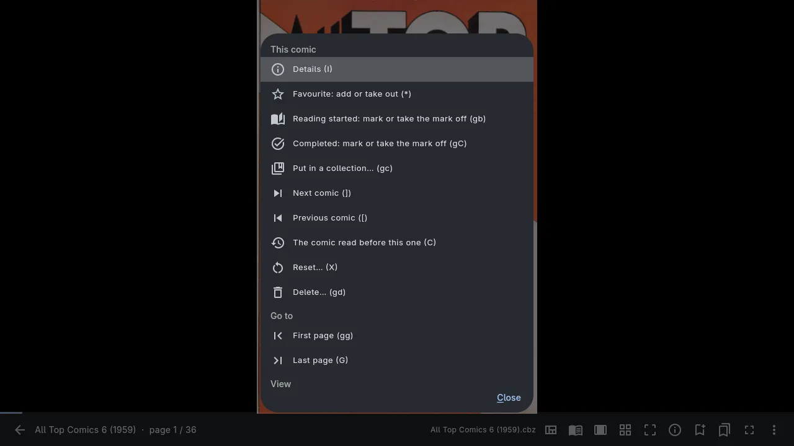
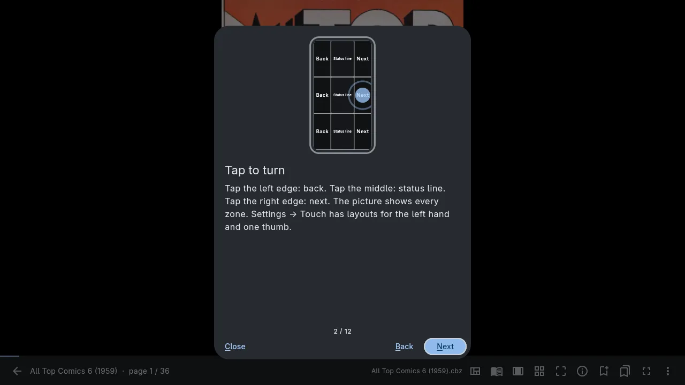
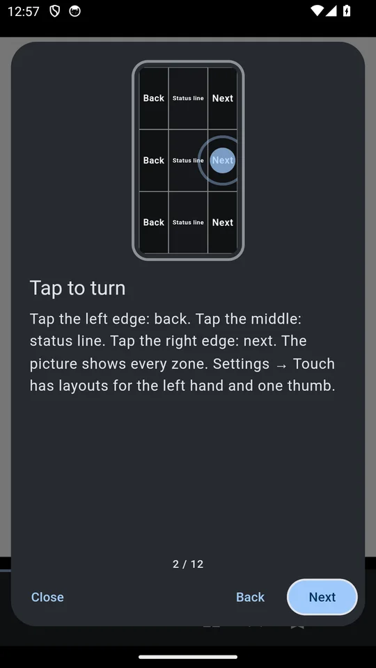
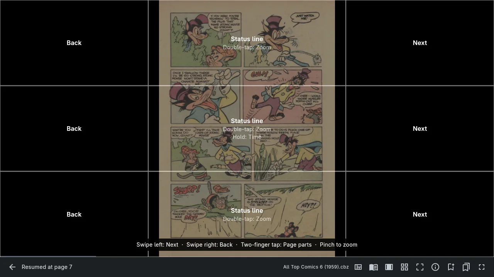
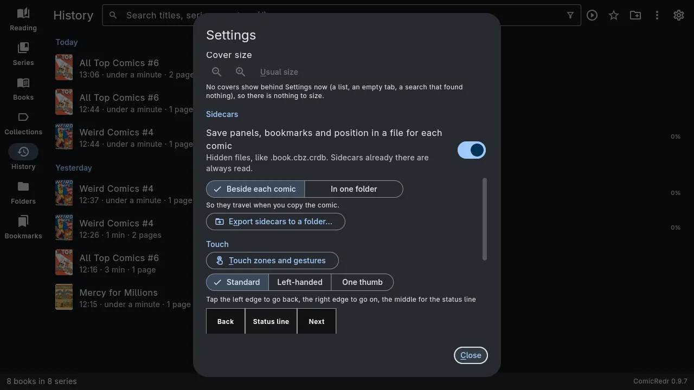
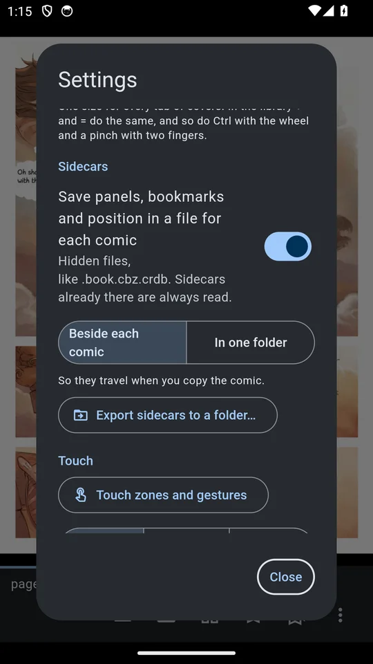

# 8. Touch

[Contents](README.md) · Previous: [Managing your comics](07-managing-comics.md) · Next: [The keyboard](09-keyboard.md)

Everything in ComicRedr works by touch, on a phone, a tablet and a Linux
laptop's touchscreen alike: every gesture below, the tap zones and your
own gestures are the same on all of them.

## Gestures

| Gesture | What it does |
|---|---|
| Tap the right edge | Next page, or next panel in guided view |
| Tap the left edge | Back |
| Tap the middle | Fullscreen on and off (and with it the status line) |
| Swipe left or right | Next or back; in guided view a quick flick, since a slower drag moves the page |
| Double-tap anywhere on the page | Fullscreen on and off |
| Pinch | Zoom in or out |
| Drag with one finger | Move around a zoomed page, a page fitted to the width, or a panel in guided view |
| Hold a finger on the middle | [The time](04-reading.md#what-time-is-it) |
| Swipe up on the page | [The menu](#the-menu-everything-without-a-keyboard), with everything the buttons leave out |
| Swipe down on the page | Fit the width, outside guided view; one finger then scrolls up and down only, and a swipe down at the top of the page brings the whole page back |
| Tap with two fingers | [Enlarge a part of the page](04-reading.md#by-touch): pick a half, third, strip or quarter, then tap the edges to go part by part |
| Drag along the progress bar | Preview pages, and let go to jump |
| Pinch the page grid | Bigger or smaller pages; drag to scroll, tap one to go there |
| Pinch the covers in the library | [Bigger or smaller covers](03-library.md#bigger-and-smaller-covers) |

Single taps wait briefly for a possible double-tap. For example,
double-tap the right edge to enter fullscreen without turning the page;
double-tap it again to leave fullscreen. Pinch to enlarge the page.

The buttons on the status line do the rest: guided view, balloons (in
guided view), fit width (outside guided view, tap it again for the whole
page), the page grid, a bookmark here, the list of bookmarks and ⋮, the
menu; on a wider screen also the comic's details, two pages side by
side, the parts of a page and fullscreen. On Android, the back gesture
works like `Esc`: it leaves guided view, then the book. On Linux the
status line starts with a back arrow that does the same. In fullscreen,
tap the middle first to bring the status line back, swipe up for the
menu, or swipe down for fit width.

In the library, on a wide screen, tap a cover to pick it and tap it
again to open it. On a narrower one (a phone, a tablet held upright, a
small window) the first tap shows its details on a page of their own,
with a **Read** button. A
long press shows a cover's details, a finger scrolls the covers, and two
fingers spread apart or pinched together make them
[bigger or smaller](03-library.md#bigger-and-smaller-covers); Settings
has two buttons that do the same.

## The menu: everything without a keyboard

Whatever a key does, the menu does too, so a phone with no keyboard
misses nothing. Tap ⋮ at the end of the status line, or swipe up on the
page; in the library ⋮ is at the end of the header. `F10` (or `g.`)
opens it with keys. Each line names its key, so the menu also teaches
the keys as you go. Tap a line, or **Close** to leave it.



On a phone it comes up from the bottom of the screen, where your thumb is.

Over a comic it has:

- **This comic:** its details, favourite, completed, put in a
  collection, the next and the previous comic, the comic read before
  this one, upload to S3 and remove from S3 (when
  [S3 sync](13-s3-sync.md) is set up), reset and delete.
- **Go to:** the first and the last page, the next and the previous
  bookmark (when the comic has some), and back to before a jump.
- **View:** enlarge a part of the page; in guided view, balloon by
  balloon, the whole page before and after its panels and holding on a
  page shown whole; outside it, two pages side by side, pairing them the
  other way, fit width, fit height and fit the whole page; right to
  left, and turning the comic either way or back upright.
- **Picture:** trim the scan margins, the night filter and the clean-up
  of old scans. A tick shows what is on.
- **App:** back to the library, fullscreen, the time,
  **Touch zones and gestures** ([one tutorial](#the-touch-tutorial)),
  **Keyboard shortcuts** and Settings.

In the library it has opening a comic or a folder of pages without
adding it, adding a library folder, rescanning, the comics the last scan
could not read and the Favourites; the filter, and the next choice of
its Completed part (as `gF`); on the Folders tab the sort; with covers shown shuffle, bigger and smaller covers and marking
every comic shown; and the same **App** lines. Everything about one
comic is in its details: hold a cover, or tap it on a phone.

## The touch tutorial

**Touch zones and gestures** is one tutorial for the tap zones and all
gestures on Android and Linux. The first time ComicRedr starts on
Android it opens automatically. Each page teaches one gesture: the
live map of where to tap, swiping, double-tapping, zooming, guided view, the
two-finger tap, holding a finger down, the status line's buttons, the
menu and the library. Swipe or tap **Next** to go on, **Close** to stop
at any point. It is drawn for the touch layout you picked, so a
left-handed layout shows its own taps.

| | |
|---|---|
|  |  |
| The tutorial on the laptop | and on the phone |

To see it again, pick **Touch zones and gestures** in the menu or in Settings →
**Touch**, or press `gT`.

## The tap zones

The page is split into nine zones: three columns (the side ones each 30%
of the width) and three rows. The tutorial's **Tap to turn** page draws
what each zone does for your layout and custom gestures. For a quick
reminder while reading, press `gt` to show the same zones over the page;
the overlay fades after a moment.



Settings → **Touch** has three layouts:

| Layout | For |
|---|---|
| **Standard** | Tap the left edge to go back, the right edge to go on, the middle for the status line. |
| **Left-handed** | Mirrored for the left thumb: the left edge goes on, the right edge goes back. |
| **One thumb** | Tap almost anywhere to go on; only the top row goes back. |

| | |
|---|---|
|  |  |
| Settings on the laptop | and on the phone |

The first comic you open after picking a layout shows its zones for a
few seconds.

## Your own gestures

Any tap, double-tap or long press in any of the nine zones, the four
swipes and a two-finger tap can do any action ComicRedr has. You set them
in the `[touch]` section of `keys.toml`; [chapter 9](09-keyboard.md#your-own-keys)
shows how. For example, to make a long press in the top right corner set a
bookmark:

```toml
[touch]
longPress = [
  "", "", "bookmark",
  "", "showTime", "",
  "", "", "",
]
```

Each action is called by its name in [docs/keys.toml](../keys.toml)
(`nextStep`, `bookmark`, `fullscreen`, …), and `""` does nothing. A line
replaces that whole gesture, which is why the example keeps the time in
the middle. The gestures you don't list keep what the layout picked in
Settings gives them. Pinch zoom and
dragging a zoomed page always work and can't be changed.

To make double-taps zoom in on the spot you tap and back out again, put
`doubleTap = "zoomToggle"` under `[touch]`. To disable double-taps and
make single taps act at once, use `doubleTap = ""`.

[Contents](README.md) · Previous: [Managing your comics](07-managing-comics.md) · Next: [The keyboard](09-keyboard.md)
